

Tesi di Laurea Magistrale

# Implementazione di una pipeline per la generazione di mesh 3D a partire da modelli CAD 2D di planimetrie architettoniche

Candidato<b>Simone Vaiasinni</b>
RelatoreProf. Nicola Capodieci
CorrelatoreProf. Fabio Pellacini

<b>Laurea Magistrale in Informatica</b> 
Università degli Studi di Modena e Reggio Emilia · A.A. 2025/2026

---

<!-- 
DESCRIZIONE DEI PROBLEMI

2. le finestre a volte venivano rappresentate come buchi tra i muri mentre altre volte venivano sovrapposte ai muri, a volte veniva rappresentato il vetro interno e altre volte no, ecc.

3. le porte a volte rappresentate con l’anta e l’arco di apertura mentre altre come porta battente a 2 ante, altre volte possono essere rappresentati come dei rettangoli.

4. la geometria presentasse talvolta del rumore e imperfezioni. Succedeva che erano presenti segmenti/punti residui lasciati durante la modifica del disegno, oppure i muri risultavano "rotti" (aperti) e non erano dei poligoni chiusi, estremità non coincidenti per piccole distanze

5. succedeva che nel caso delle porte queste venissero rappresentate o salvate in modo diverso, perché quando provavo a fare il parsing su modello (draftperson) funzionava mentre se provavo su un altro modello (archweb) non funzionava più nel senso che i segmenti venivano plottati in modo errato nonostante la procedura fosse uguale per entrambi.

-->

# Introduzione: dal CAD 2D al modello 3D

## Obiettivo

Da una planimetria CAD di una stanza o di un appartamento generare un **modello 3D** e renderizzarlo in **Blender** con materiali e asset.

## La sfida

L'algoritmo deve:
- capire **quali segmenti formano un muro**, dove c'è un'**apertura** e ricostruirla
- capire quali **blocchi** sono porte o finestre e dove posizionarli

## Difficoltà

- Un CAD contiene solo **geometria** (linee, archi, polilinee, blocchi), non la **semantica** dell'edificio
- Un autore può utilizzare una convenzione diversa e rappresentare gli elementi in modi differenti.
- **Layer** con nomi diversi, anche in lingue diverse
- **Rumore e imperfezioni** da rimuovere o correggere
- **Unità di misura** diverse
- Alterazioni nella **conversione DWG → DXF**

---

# Passo 0: Preprocessing

L'obiettivo è pulire il disegno e renderlo più <b>consistente</b>

<figure>
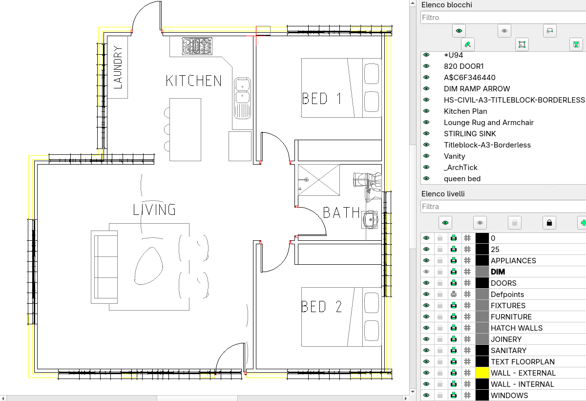
<figcaption>Modello di partenza: disegno, layer e blocchi</figcaption>
</figure>

## 1. Nomi

Layer e blocchi rinominati: `A-WALL` `A-DOOR` `A-WINDOW` `BLOCK-DOOR` `BLOCK-WINDOW`

## 2. Pulizia

Rimossi gli elementi inutili o problematici (es. `WALL-EXTERNAL`)

## 3. Correzione

Contorni dei muri chiusi e blocchi delle finestre ripuliti

---

<figure>
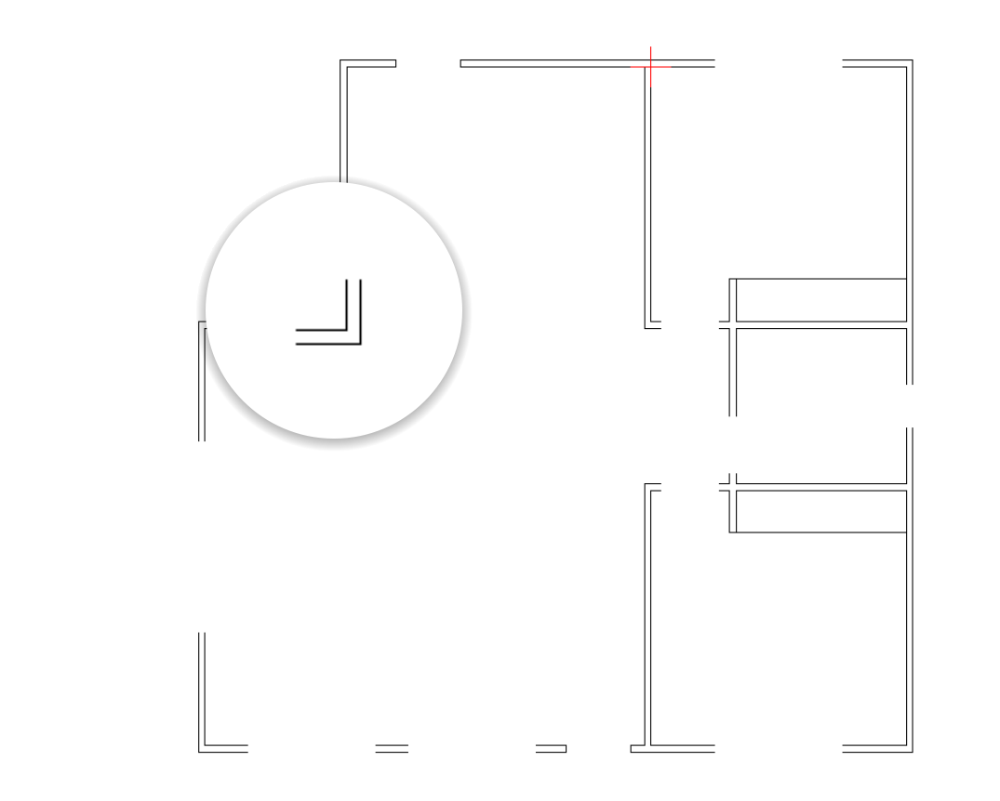
<figcaption><b>Muri</b>La geometria appare rotta</figcaption>
</figure>
<figure>
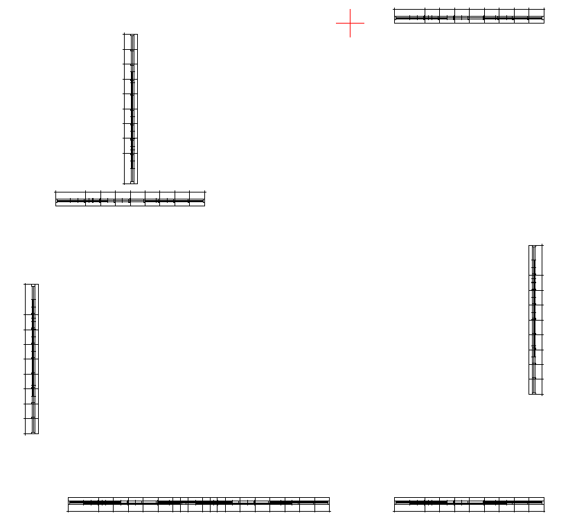
<figcaption><b>Finestre</b>Una finestra può contenere fino a un centinaio di vertici</figcaption>
</figure>

---

<figure>

<figcaption>Prima</figcaption>
</figure>

&rarr;

<figure>
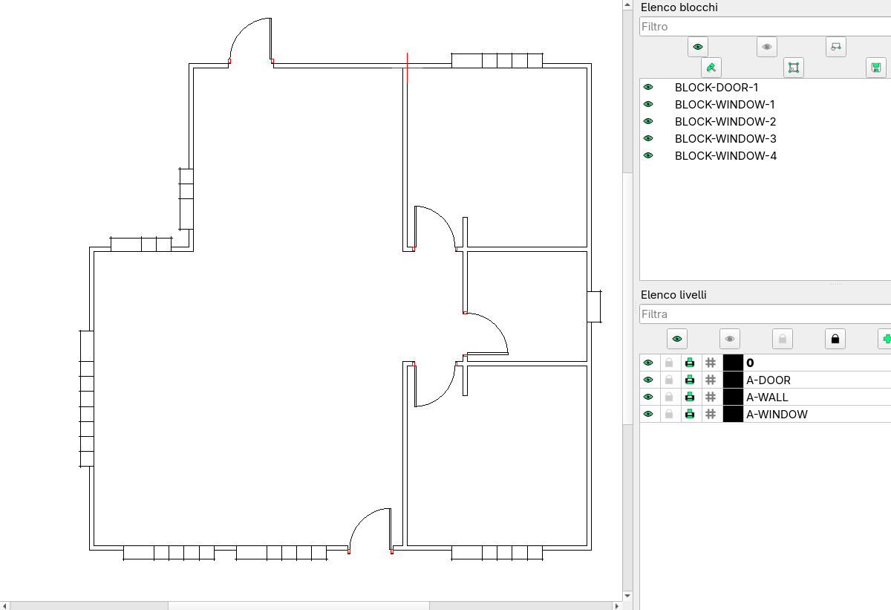
<figcaption>Dopo: layer e geometria corretti</figcaption>
</figure>

---

<!-- 
Il formato DXF organizza il disegno in primitive geometriche: LINE, POLYLINE, ARC, CIRCLE, ecc. Queste entità sono raggruppate in layer e blocchi (componenti riutilizzabili comunemente impiegati per rappresentare porte e finestre).

L’obiettivo della fase di parsing è estrarre da queste primitive le informazioni geometriche necessarie alla costruzione della mesh. Siccome sappiamo come sono strutturati i nomi dei layer/blocchi ci viene molto più facile estrarre le primitive collassando tutte le primitive sotto forma di segmenti, così da ottenere una rappresentazione uniforme.

Un segmento è semplicemente un coppia di vertici a cui viene associato un TAG che ne indica la semantica (muro, porta o finestra).

Quasi sempre, le primitive più uilizzate nei disegni sono: LINE (coppia di vertici), POLYLINE (contorno chiuso) e ARC. Questi ultimi sono tipici delle porte: si estrae il raggio, il punto base, l’angolo iniziale e finale e a partire da questi dati si calcolano i due punti estremi.
-->

# Passo 1: Parsing

## Primitive DXF

`LINE`, `POLYLINE`, `ARC`, `CIRCLE`... raggruppate in **layer** e **blocchi** (componenti riutilizzabili, usati per porte e finestre)

## Obiettivo

Estrarre muri, porte e finestre, collassando tutte le primitive sottoforma di **segmento**:
$S = <\mathbf{p_0, p_1,} \text{TAG}>$
$TAG = \{ \text{WALL, DOOR, WINDOW} \}$

## Risultato

**3 insiemi distinti** di segmenti: muri, porte, finestre

<figure>
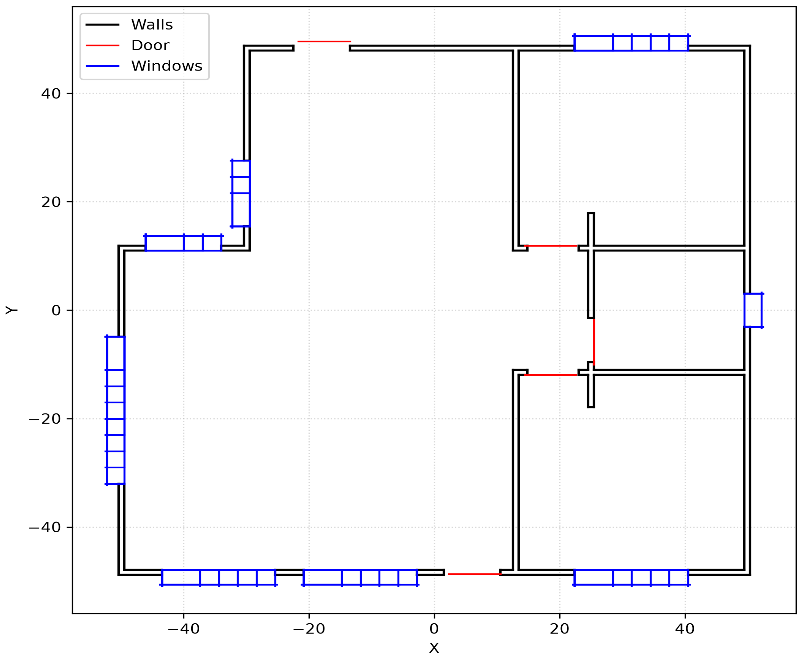
<figcaption>Risultato del parsing</figcaption>
</figure>

---

<!-- 
Nei disegni CAD, in uno stesso punto ci sono più vertici (appartenenti a segmenti diversi) sovrapposti oppure molto vicini da essere indistinguibili. Questa operazione serve sia a ridurre il numero di vertici da elaborare ma soprattutto per riuscire a rappresentare la geometria come grafo con vertici univoci.

L’obiettivo è prendere l’insieme dei segmenti e rimuovere vertici che sono considerati in più, ovvero che distano meno di $epsilon$. Per risolvere questo problema in modo efficiente si è scelto di implementare una struttura dati spaziale efficiente: un hash spaziale.
Il funzionamento è semplice: lo spazio 2D viene suddiviso in una griglia regolare, in cui ogni cella ha una dimensione fissa. A ciascun punto viene associata esattamente una cella, calcolata in base alle sue coordinate (posizione).
Una proprietà interessante di questa struttura è che se la dimensione della cella è scelta pari al raggio di ricerca 𝑟, due punti che distano meno di 𝑟 si trovano necessariamente nella stessa cella oppure in una delle celle immediatamente adiacenti.
Questo significa che, per rispondere a un’interrogazione centrata in un punto 𝑝, non è necessario esaminare l’intero insieme di punti, ma è sufficiente fare una ricerca nella griglia 3x3

Il parametro epsilon definisce il raggio di ricerca 𝑟 e di conseguenza la dimensione della cella. Dato un punto 𝑝, cerca nella griglia 3x3 un vertice già esistente che disti meno di epsilon; se esiste già il nuovo vertice viene scartato senza essere inserito nella griglia, altrimenti viene inserito.
In questo caso è stato utilizzato epsilon=10^(-2) per avere una riduzione di circa il 50% dei vertici. In generale non esiste un valore unico per tutti i modelli, occorre provare e verificare.

Durante la creazione della struttura spaziale prendo ogni singolo segmento (dei muri) e rimuovo i duplicati, ma allo stesso tempo mi salvo gli archi Edge con riferimenti ai due vertici estremi. Alla fine io otterrò sia l'insieme dei vertici univoci V, sia anche la lista degli archi E. Praticamente un grafo.
-->

# Passo 2: Collasso dei vertici

<figure>
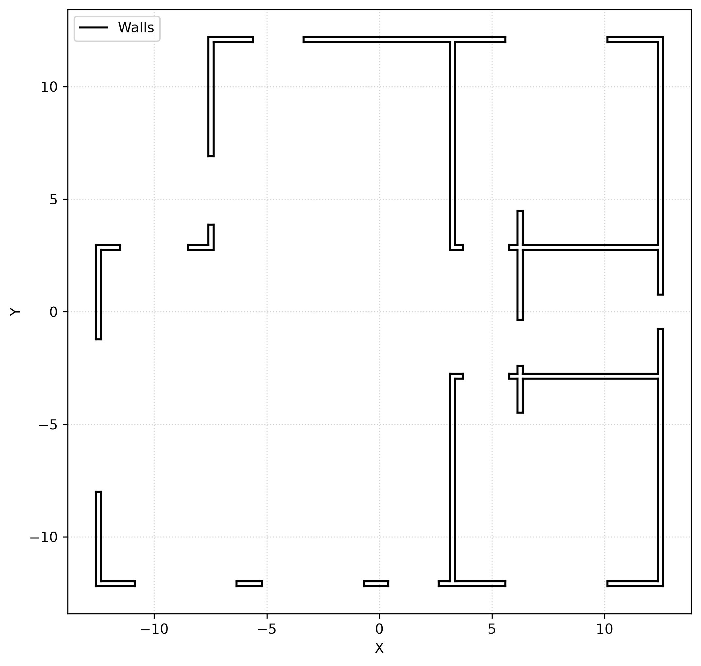
<figcaption>Input: segmenti dei muri</figcaption>
</figure>
<figure>

<figcaption><b>Prima</b>176 vertici</figcaption>
</figure>
<figure>
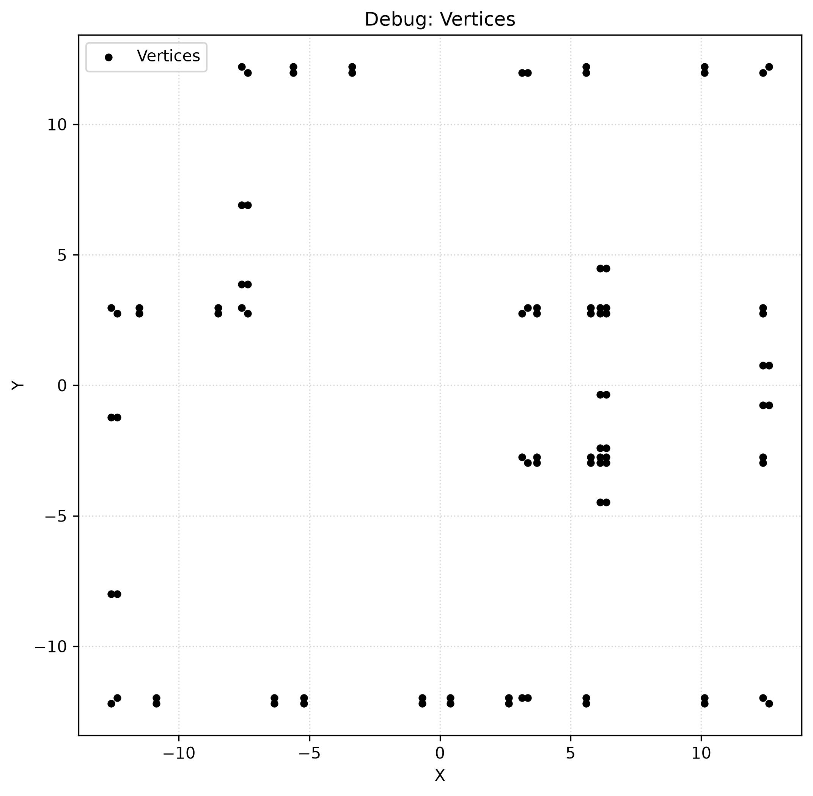
<figcaption><b>Dopo</b>88 vertici (50% in meno), SSIM: 0.999</figcaption>
</figure>

## Problema

Vertici **duplicati**, sovrapposti o così vicini da essere indistinguibili

## Obiettivi

1. **Ridurre** il numero di vertici da elaborare
2. Rappresentare la geometria come **grafo** con vertici univoci

---

# Hash spaziale

<figure>
<video src="figures/recording-spatial-hash.mp4" autoplay loop muted playsinline></video>
</figure>

## Griglia

Spazio 2D diviso in **celle di lato fisso**: ogni punto cade in una cella, in base alle sue coordinate

## Ricerca 3×3

Con cella pari al raggio $r$, due punti a distanza $< r$ stanno in una cella adiacente: basta cercare nelle **3×3 celle**

## Regola

$\varepsilon$ = raggio di ricerca = lato della cella. Se esiste un vertice a distanza $< \varepsilon$ il nuovo viene **scartato**, altrimenti **inserito**. Qui $\varepsilon = 10^{-2}$ (da tarare per ogni disegno)

## Risultato

Vertici univoci $V$ e archi $E$: un **grafo non connesso** $G = \langle V, E \rangle$

---

<!-- 
Ricostruzione dei varchi

1. Ricostruzione porte

L'idea è di iterare su tutti i segmenti (rossi) delle porte, prelevare le due estremità (vertici) e, sfruttando la struttura spaziale, cercare i due vertici di muro più vicini che rappresentano i punti di giunzione. Una volta recuperati i due vertici di giunzione inseriamo un nuovo Edge (con tag:DOOR).

Per capire meglio osserviamo la seguente immagine:  Grafo dei muri e nuovo arco (tag DOOR) tra i vertici 𝐶 e 𝐷, individuati come i vertici dei muri più vicini alle estremità del segmento della porta.
<figures/3_progettazione_pipeline/wall_graph.png>

Inserire un solo segmento non ci basta. Per ottenere un poligono semplice è necessario inserire un secondo arco (parallelo) tra i vertici 𝐴,𝐵. 
Il criterio per individuare 𝐴 e B: conosciamo i due vertici di giunzione C,D e calcoliamo il versore CD. Consideriamo il vertice C e i suoi due vicini che sono F,A. Dobbiamo verificare quale dei due vertici il vettore risultante sia ortogonale a CD. Si sfrutta la proprietà del prodotto scalare tra due vettori unitari: se il risultato è 0 i due vettori sono perpendicolari; altrimenti se è -1 sono opposti.
In questo caso il vertice candidato è A:
- CD dot CF = -1 
- CD dot CA = 0

Dall'altra parte il vertice candidato è B:
- CD dot DH = -1 
- CD dot DB = 0

Inseriamo il secondo Edge tra A,B.
Figura: inserimento del secondo edge.
<figures/3_progettazione_pipeline/wall_graph2.png>

2. Ricostruzione finestre
In questo caso ogni finestra contiene decine di segmenti e vertici. In altri modelli possono essere rappresentate in maniera più o meno diversa. è necessario un approccio più generale basato sul clustering spaziale. 
L’obbiettivo è di raggruppare dei punti in gruppi (cluster). Un parametro fondamentale è il raggio di prossimità `r`: per ogni punto viene considerato un piccolo cerchio di raggio r, si contano quanti punti cadono dentro al cerchio e se il numero è maggiore di `m` allora è un "core point". In altre parole, se in un intorno di un punto p sono presenti almeno 2 punti allora si dice essere core point e viene assegnato ad un certo cluster.  I punti che si trovano vicino al core point vengono considerati dentro al cluster. è importante impostare bene il raggio `r` perché troppo grande tende a far collassare cluster distinti in un unico
cluster; al contrario, un valore troppo piccolo produce una frammentazione eccessiva.
<3_dbscan.png> -> <7_dbscan.png>

Per ogni finestra viene calcolato un cluster indipendente. Qua il valore `m` è di default 2, mentre deve essere tarato il valore `r` (diverso da disegno a disegno). 
Per il clustering vengono generati nuovi punti campionati dai singoli segmenti di finestre e su questi nuovi punti si esegue l'algoritmo di clustering.

Dopo che abbiamo generato i cluster, calcoliamo per ognuno il bounding box da cui si estrae uno dei due lati lunghi, che sarà il segmento che collega i due vertici dei muri. In questo modo si applica lo stesso ragionamento e procedura appena vista per le porte. L’unica differenza rispetto al caso delle porte è che gli edge vengono taggati WINDOW anziché DOOR.
<cluster.jpg>

Importante: alla fine della ricostruzione non sono stati creati nuovi vertici, ma sono solo stati aggiunti nuovi edge.

Figura: Rappresentazione finale
<doors-windows-connected.jpg>
-->

# Passo 3: Ricostruzione porte

<figure>
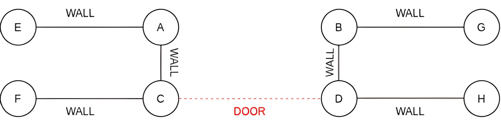
<figcaption>Nuovo arco (tag <code>DOOR</code>) tra C e D, i vertici dei muri più vicini agli estremi della porta</figcaption>
</figure>

## Problema

Il grafo appena creato contiene solo i **muri**. I segmenti delle porte collegano due vertici di muro, ma non sappiamo quali

## Idea

Per ogni segmento rosso (porta) prendo i due estremi e, con la struttura spaziale, cerco i vertici di muro più vicini: i punti di giunzione ($C$, $D$)

## Risultato

Nuovo edge $e = \langle C, D, \text{DOOR} \rangle$

---

# Passo 3: Ricostruzione porte (2)

<figure>
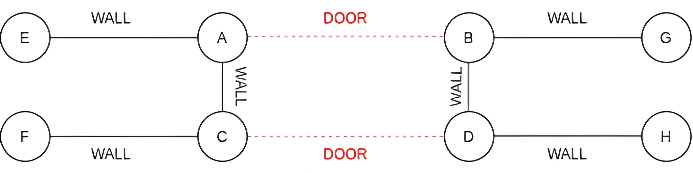
<figcaption>Inserimento del secondo edge tra A e B</figcaption>
</figure>

## Problema

Un solo edge non basta per ottenere un **poligono chiuso**: serve un secondo edge tra $A$ e $B$

## Come trovare A e B

Calcolo il versore $\vec{CD}$. Tra i vicini di $C$ ($F$, $A$) scelgo quello **ortogonale** a $\vec{CD}$, sfruttando il prodotto scalare tra versori

## In pratica

$\vec{CD}\cdot\vec{CF} = -1$, $\ \vec{CD}\cdot\vec{CA} = 0 \to$ **A**

$\vec{CD}\cdot\vec{DH} = -1$, $\ \vec{CD}\cdot\vec{DB} = 0 \to$ **B**

## Risultato

Nuovo edge tra $A$ e $B$. Nessun vertice nuovo inserito.

---

# Passo 3: Ricostruzione finestre (clustering DBSCAN)

<figure>
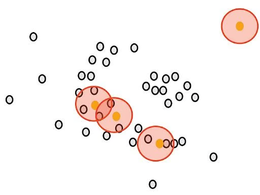
<figcaption>Punti campionati dai segmenti</figcaption>
</figure>

&rarr;

<figure>
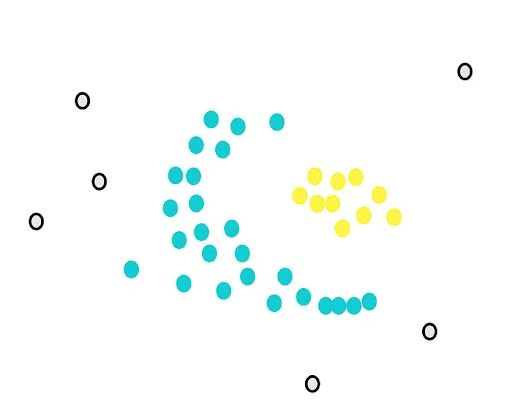
<figcaption>Cluster individuati</figcaption>
</figure>

## Perché

Ogni finestra ha decine di segmenti e cambia da modello a modello: serve un approccio generale

## Parametri

Raggio $r$ (da tarare per ogni disegno) e $m = 2$: se nell'intorno di $p$ ci sono almeno 2 punti, $p$ è un **core point**

## Attenzione a $r$

**Troppo grande**: cluster distinti si fondono. **Troppo piccolo**: frammentazione

---

<figure>
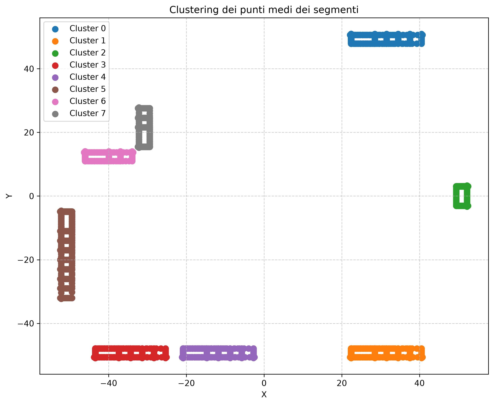
<figcaption>Cluster e bounding box di una finestra</figcaption>
</figure>
<figure>
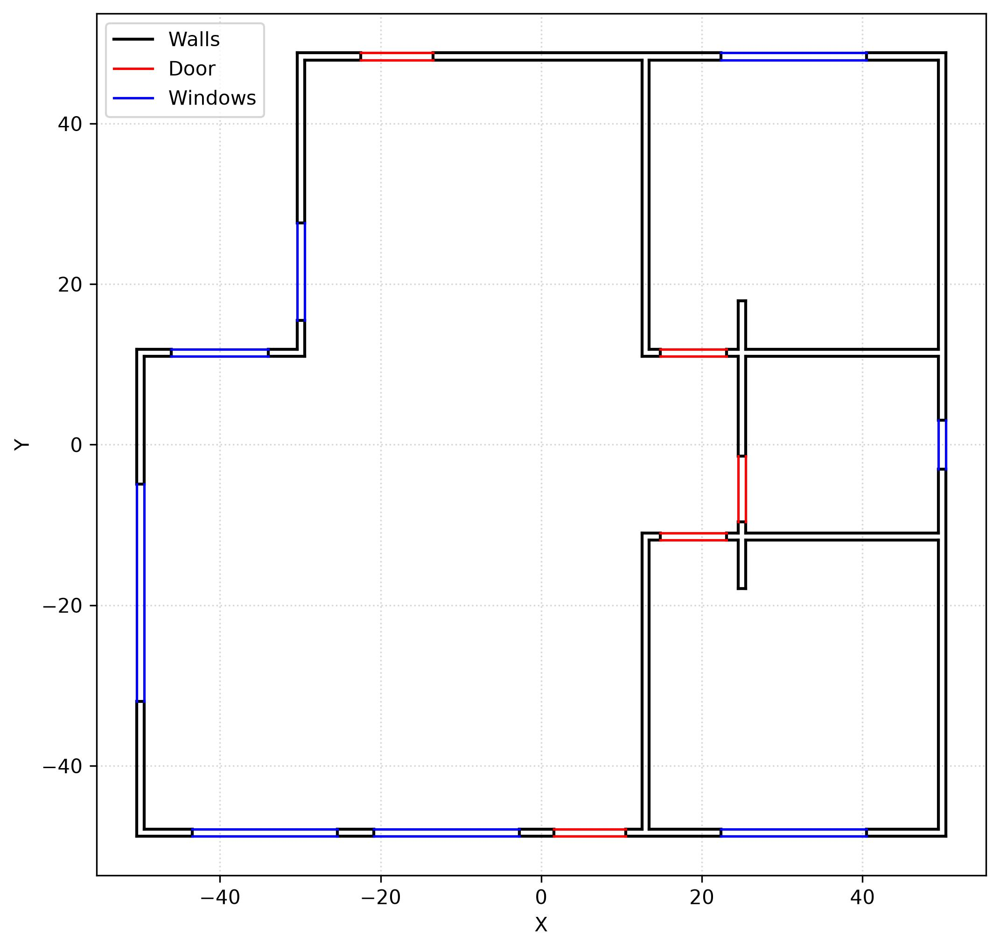
<figcaption>Grafo connesso con porte e finestre ricostruite</figcaption>
</figure>

## Procedura

**Bounding box** del cluster → **lato lungo** come segmento di giunzione → stessa procedura delle porte, con $\text{TAG = WINDOW}$

## Importante

**Nessun nuovo vertice**: sono stati aggiunti solo nuovi edge

<!--
Estrazione Facce

Le strutture dati per la connettività derivano dall’idea di rappresentare una mesh come grafo: un insieme di vertici e di archi, a cui si aggiunge un insieme di facce definite come cicli ordinati di vertici o archi.
Un grafo è planare se può essere disegnato senza che i suoi archi si intersechino. Quando gli archi non sono curvi ma sono semplicemente rettilinei si parla di Grafo Planare Rettilineo (Planar Straight-Line Graph): ed è il punto di partenza per operazioni come l’estrazione delle facce racchiuse dal grafo.

Domanda: Non è possibile estrarre le facce usando unicamente quel grafo?
Il grafo da solo non basta. Il grafo contiene vertici ed edge, ma non dice in che ordine gli edge si dispongono attorno a un vertice. Una faccia è un ciclo chiuso che, a ogni vertice, gira sempre dallo stesso lato (ad esempio all’edge successivo in senso antiorario).
`twin` e `next` sono quell’ordinamento già calcolato. Quindi l’Half-Edge non è un’alternativa al grafo, ma lo arricchisce con la connettività.

Oltre alla semplice memorizzazione indicizzata, esistono diverse strutture pensate per rendere esplicita ed efficiente la navigazione della connettività di una mesh. Una di queste è la struttura Half-Edge (o doubly-linked edge list): per ogni edge ci sono due "half-edge" orientati in direzioni opposte, uno per ciascuna delle due facce che condividono l’arco. Ogni half-edge memorizza un riferimento alla faccia sul proprio lato dell’arco, al vertice verso cui punta, al proprio gemello (l’half-edge opposto) e all’half-edge successivo lungo il perimetro della propria faccia. Percorrendo ripetutamente questi riferimenti "successivi" si ottiene un ciclo chiuso corrispondente esattamente al contorno di una faccia.
<cgal-halfedge.png>, <half-edge.png>

L'informazione sul tipo di segmento (WALL, DOOR, WINDOW) viene mantenuta sugli half-edge e ai loro twin, così da essere disponibile per la classificazione delle facce.

Per implementare questa struttura è stata utilizzata la libreria CGAL che fornisce tra le altre la struttura Arrangement che contiene vertici, half-edge orientati e una lista di poligoni (facce). 
-->

---

# Passo 4: Estrazione delle facce

<figure>

<figcaption>Grafo dopo la ricostruzione dei varchi</figcaption>
</figure>

## Input

Grafo planare con vertici univoci ed edge con TAG (`WALL`, `DOOR`, `WINDOW`)

## Obiettivo

Estrarre le facce: cicli chiusi di edge, cioè **poligoni 2D**

## Problema

Il grafo dice chi è collegato a chi, ma non l'ordine degli edge attorno a un vertice: serve una struttura che renda esplicita la **connettività**

---

# La struttura Half-Edge

<figure>
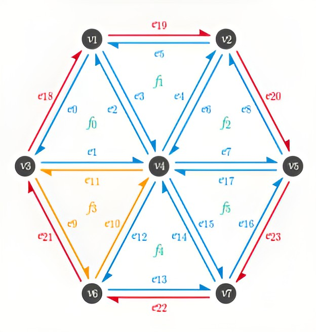
<figcaption>Due half-edge opposti per ogni edge</figcaption>
</figure>
<figure>
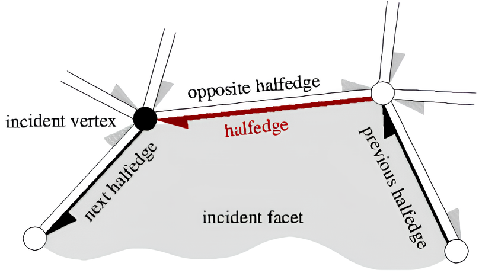
<figcaption>Half-edge in CGAL</figcaption>
</figure>

## Ogni half-edge conosce

La **faccia** sul suo lato, il **vertice** a cui punta, il **twin** (opposto) e il **next** lungo la faccia

## Percorrendo i next

Si ottiene un **ciclo chiuso**: il contorno di una faccia

## CGAL Arrangement

Vertici, half-edge e **lista di facce**. I **tag** restano su ogni half-edge e sul suo twin. Risultato: **poligoni 2D**

---

<!-- 
Classificazione Facce

Classificare le facce è NECESSARIO per effettura l'estrusione differenziata. Itero su tutte le facce e le classifico in base a quali tipi di segmenti è costituita: ad esempio posso considerare una faccia DOOR se è costituita esattamente da 2 edge rossi (DOOR) e 2 edge neri (muri), una faccia WINDOW se è costituita esattamente da 2 edge blu (WINDOW) e 2 edge neri, oppure una faccia DOOR se è costituita da tutti segmenti neri. 
<faces.png>
-->

# Classificazione delle facce

<figure>
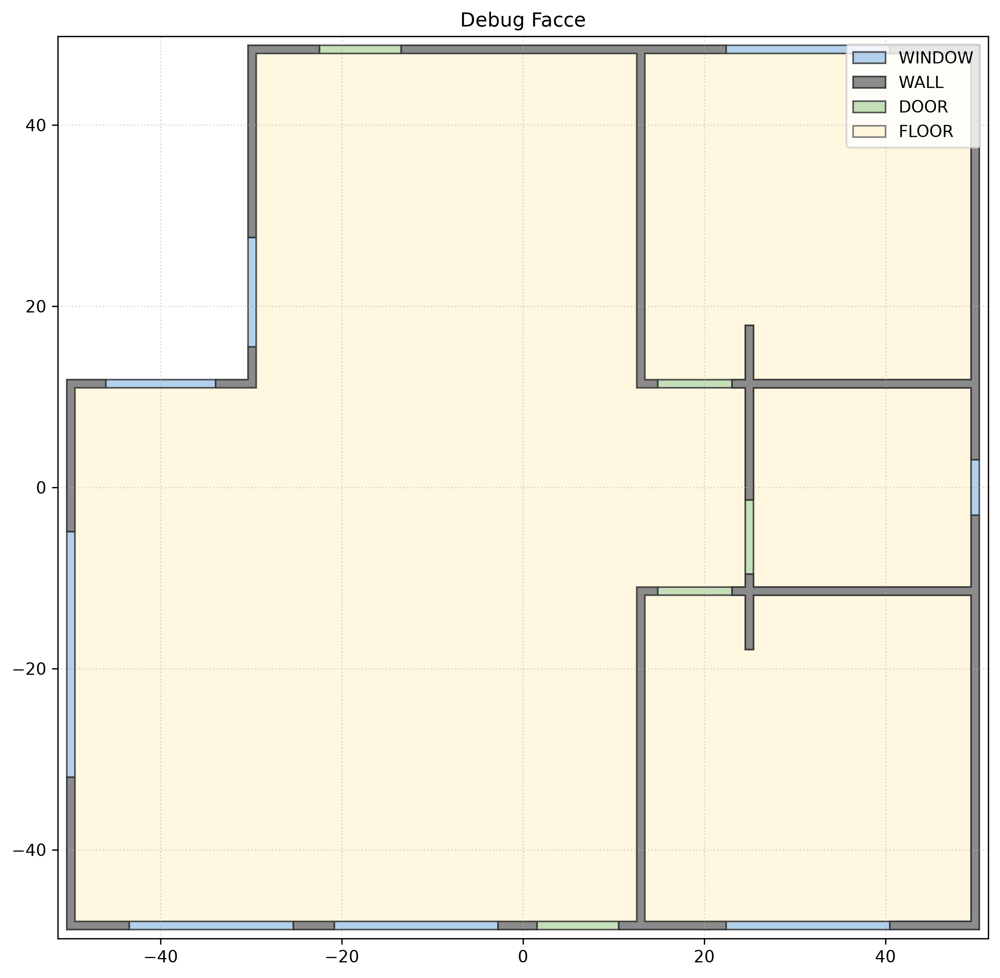
<figcaption>Facce classificate: stanze, porte e finestre</figcaption>
</figure>

## Perché

Serve per l'**estrusione differenziata**: ogni tipo di faccia ha un'altezza diversa

## Porta

2 edge `DOOR` + 2 edge `WALL`

## Finestra

2 edge `WINDOW` + 2 edge `WALL`

## Muri

Solo edge `WALL`

---

<!-- 
Estrusione 

L’estrusione è il processo di trasformare forme 2D a forme tridimensionali assegnando un'altezza e una direzione. Consiste nel trasformare poligoni in solidi lungo un asse.
Siccome noi non abbiamo a che fare con forme particolari o forme curve, il procedimento è molto semplice: si duplicano i vertici del piano 2d, si traslano ad una certa altezza e per ogni lato si crea un quad verticale (definito da 2 triangoli).
<Processo_di_estrusione_da_2D_a_3D.png>, <estrusione_poligono_muro_CAD.gif>
-->

# Passo 5: Estrusione differenziata

<figure>
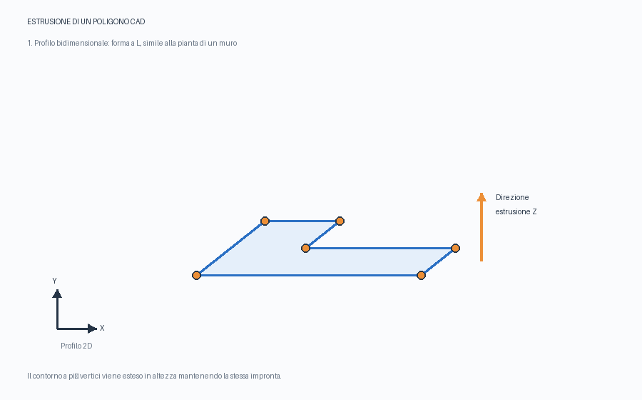
<figcaption>Da poligono 2D a solido 3D</figcaption>
</figure>

<figure>
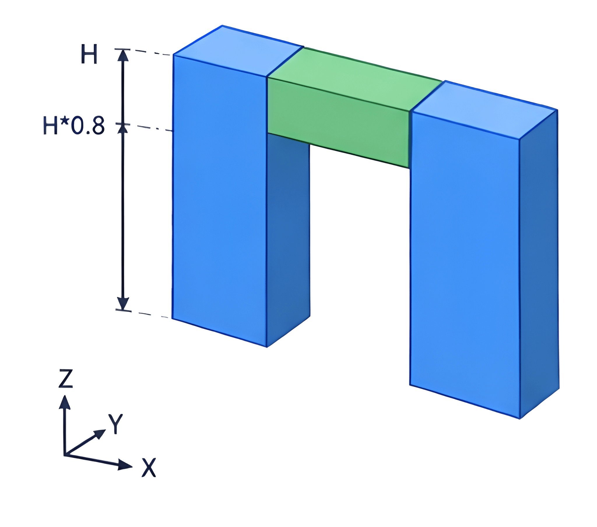
<figcaption>Porta</figcaption>
</figure>
<figure>
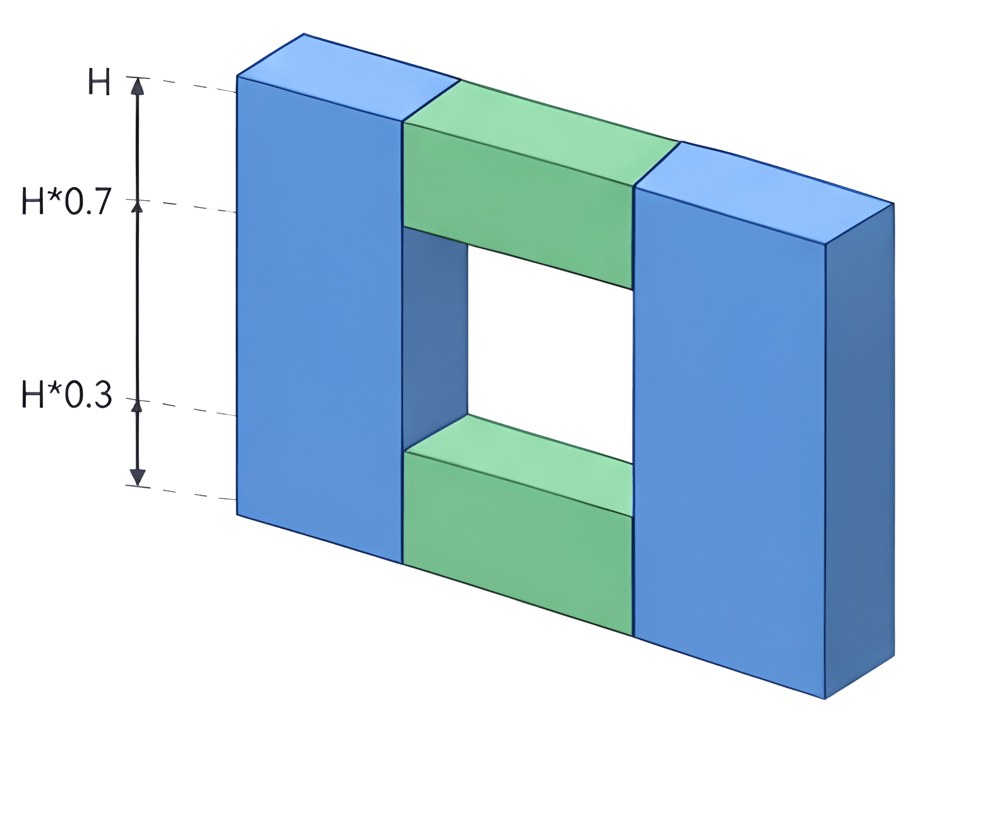
<figcaption>Finestra</figcaption>
</figure>

<!-- 
Rappresentazione di una mesh

La maggior parte dei modelli 3D utilizzati in applicazioni reali è composta da triangoli. Una mesh triangolare è una rete di triangoli connessi tramite vertici e archi condivisi a formare un’unica superficie continua. I triangoli possono essere memorizzati come entità indipendenti, ciascuna con i propri tre vertici (duplicazione dei vertici e spreco di spazio), oppure memorizzare una sola volta ciascun vertice distinto e far sì che ogni triangolo vi faccia riferimento tramite un indice (indexed triangle mesh). Un vertice può essere arricchito con attributi aggiuntivi: normale e texture coordinate che sono fondamentali durante i calcoli di shading (illuminazione)
Figura: rappresentazione di una indexed triangle mesh
<indexed-triangle-mesh.png>

Algoritmi di triangolazione
Un problema classico della computer grafica è quello di scomporre un poligono semplice in triangoli. La scomposizione di un poligono semplice in triangoli è chiamata triangolazione del poligono. Qua è stato considerato Constrained Delaunay Triangulation. 
Il flusso classico per costruire un CDT:
1. triangolazione iniziale (utilizzando ad es. Ear Clipping o Sweep Line Algorithm). Nel mio caso con Poly2tri utilizza Sweep Line.
2. si applica l'algoritmo di Flip di Lawson solo sugli archi interni che violano la condizione di Delaunay.

La condizione di Delaunay per un insieme di punti: nessun punto deve trovarsi all'interno del cerchio circoscritto di un triangolo. Il centro di questo cerchio è chiamato centro del cerchio circoscritto al triangolo ed è equidistante da tutti i vertici.

CDT presenta due caratteristiche importanti: evita la formazione di triangoli degeneri; consente di specificare esplicitamente quali segmenti debbano necessariamente far parte della triangolazione risultante.

Dal punto di vista della complessità computazionale, nel caso in cui l’input sia un singolo poligono semplice, la CDT può essere calcolata in tempo lineare O(𝑛).
<recording_DT.webm>
-->

---

# Rappresentazione di una mesh

<figure>
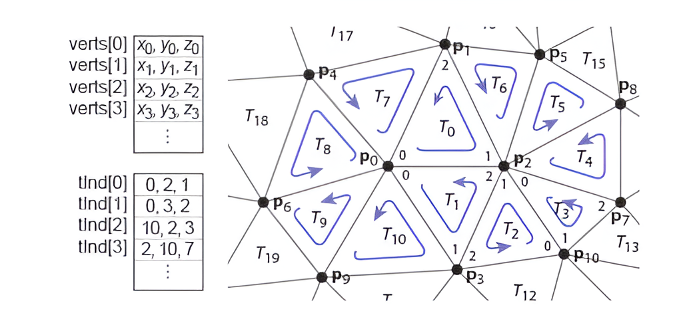
<figcaption>Indexed triangle mesh: buffer dei vertici e buffer degli indici</figcaption>
</figure>

## Mesh triangolare

Rete di triangoli connessi, che non deve contenere buchi

## Vertici

Salvati in un **vertex buffer**.

Per ogni vertice vengono calcolati e memorizzati i seguente attributi: posizione, normale, texture coordinate.

## Indici

Ogni triangolo richiama i suoi vertici gli indici.

L'insieme degli indici sono salvati in un **index buffer**.

---

# Passo 6: Triangolazione di Delaunay

<figure>
<video src="figures/recording_DT.mp4" autoplay loop muted playsinline></video>
<figcaption>Flip degli archi che violano la condizione di Delaunay</figcaption>
</figure>

## Problema

Scomporre un poligono semplice in triangoli, usando l'algoritmo **Constrained Delaunay Triangulation**

## Flusso

1. **Triangolazione iniziale** (Ear Clipping, Sweep Line). Qui: Poly2Tri con Sweep Line
2. **Flip di Lawson** solo sugli archi interni che violano la condizione di Delaunay

## Condizione di Delaunay

Nessun punto dentro il cerchio circoscritto di un triangolo

## Vantaggi

Evita i **triangoli degeneri** e permette di imporre segmenti obbligatori

---

# Mesh Preview

<figure>
  <video src="figures/mesh-preview.mp4" autoplay loop muted playsinline></video>
<figcaption>Mesh 3D generata dalla pipeline (prima dell'inserimento degli asset)</figcaption>
</figure>

<!--
Esportazione

Adesso abbiamo una mesh tridimensionale effettiva  con vertici, indici, normali e texture coordinates. La mesh deve essere esportata in formato aperto (GLTF).

Se provassi a renderizzare la mesh così com'è vedrei dei semplici buchi vuoti a ridosso di porte e finestre. Non è ancora accettabile. Vogliamo la possibilità di potere inserire degli asset 3D.

Una prima ipotesi era inserire gli asset direttamente nel processo di generazione della mesh, ma questo approccio risulta poco conveniente. Consideriamo solo il caso delle porte. Un asset di una porta dettagliata può arrivare a contenere centinaia/migliaia di vertici. Se in un appartamento sono presenti 10 porte, la geometria della porta verrebbe duplicata 10 volte, aumentando notevolmente la dimensione del file. Oppure, Inoltre, se si vuole cambiare asset oppure modificare l’orientamento di una porta bisognerebbe rieseguire l’intera pipeline. Occorre anche preservare i materiali originali dell’asset scaricato, complicando ulteriormente il processo.

La soluzione più flessibile e mantenibile consiste nell’adottare un approccio a placeholder, spostando il caricamento degli asset direttamente in Blender. Blender gestisce l'instancing: consideriamo una una mesh di una porta ripetuta tante volte, i vertici della stessa mesh non vengono duplicati tante volte quante il numero di porte. I vertici sono allocati una volta sola e condivisi tra le altre instance. Quello che cambia è la matrice di trasformazione (traslazione, scala, rotazione) e il materiale (è possibile anche cambiare materiale alle diverse porte)

Mi serve solamente esportare informazioni su dove inserire gli asset, con quale orientamento e con quale scala. Tutte queste informazioni vengono infine serializzate ed esportate sotto forma di file JSON, insieme al modello GLTF.

In pratica la pipeline esporta due file:
- mesh GLTF
- placeholders JSON
-->

---

# Passo 7: Esportazione

## Problema

La mesh esportata in **GLTF** ha dei buchi vuoti a ridosso di porte e finestre: servono asset 3D

## Instancing in Blender

Una mesh ripetuta non duplica i vertici: sono allocati **una sola volta** e condivisi. Cambiano solo la matrice di trasformazione e il materiale

## Asset nella pipeline (scartato)

- Geometria **duplicata**: 10 porte, 10 copie
- Cambiare asset o orientamento = **rieseguire la pipeline**
- **Materiali originali** da preservare

## Approccio a placeholder (scelto)

La pipeline esporta solo dove inserire l'asset (`center`), l'**orientamento** (`rotate_z`) e la **scala**. Il caricamento avviene in Blender

## Pipeline

genera la mesh

&rarr;

## `mesh.gltf`
## `placeholders.json`

&rarr;

## Blender

carica gli asset

--- 

<!--

Rendering

Per la fase di rendering viene utilizzato Blender, sia tramite uno script Python basato sulle API bpy, sia tramite GUI.

Il file GLTF esportato contiene esclusivamente la geometria
della mesh (posizioni, normali e coordinate texture) e non include alcuna informazione sui materiali. I materiali, gli asset, l'illuminazione, la camera, l’environment map vengono definiti in Blender. Questa soluzione è anche la più flessibile: è possibile cambiare i materiali dover rieseguire ogni volta l’intera pipeline.

Inizialmente si era valutato di eseguire l’intero rendering all’interno dello script Python. Questo approccio si è tuttavia rivelato poco pratico: posizione e rotazione della camera, così come posizione e intensità delle luci, avrebbero dovuto essere codificate direttamente nel codice (hard-coded), rendendo la scelta dei parametri tediosa e poco intuitiva.

Si è quindi adottato un approccio ibrido: lo script Python automatizza le operazioni ripetitive e deterministiche, mentre la composizione finale della scena (camera e luci) è affidata alla GUI. Nello script:
- importo la mesh GLTF
- definisco i materiali (albedo, normal, roughness, ecc.) diversi per il pavimento e muri
- carico l’environment map
- leggo i placeholder e carico gli asset
- alla fine creo la scena iniziale file .blend

Il file .blend generato viene aperto in Blender tramite GUI e qua possiamo navigare e impostare la camera, posizionare le luci e modificarne le proprietà maniera più semplice. Grazie alla modalità GUI è possibile aggiungere facilmente ulteriori asset per arredarla come un divano, una TV, una lampada, ecc.

Il rendering viene eseguito con Cycles: physically-based path tracing render engine.
Il rendering è stato effettuato a risoluzione 1280x720, con 128 samples per pixel, denoiser (OpenImageDenoise), su CPU (AMD Ryzen 5 2600X) perché la mia GPU non è adatta  per PT con Cycles. 
Il tempo di rendering varia in base alla complessità della scena: da 3 a 7 minuti per una immagine.

Risultati

<rendering-1.png>
<rendering-2.png>
<rendering-3.png>
<rendering-4.png>
-->

# Rendering in Blender: approccio ibrido

## GLTF: solo geometria

Posizioni, normali e coordinate texture, nessun materiale. Materiali, asset, luci, camera ed environment map sono definiti in **Blender**: posso cambiare i materiali senza rieseguire la pipeline.

## Solo script Python? Scartato

Camera e luci (posizione, rotazione, intensità) sarebbero **hard-coded**: molto scomodo e poco intuitivo

## Script Python (`bpy`)

Operazioni ripetitive e deterministiche

1. Importa la **mesh GLTF**
2. Definisce i **materiali** (albedo, normal, roughness...) per pavimento e muri
3. Carica l'**environment map**
4. Legge i **placeholder** e carica gli **asset**
5. Crea la scena iniziale **`.blend`**

## GUI di Blender

Camera e luci impostate navigando la scena, in modo semplice. Aggiungere arredi (divano, TV, lampada) è immediato

---

# Rendering con Cycles

  <b>Cycles</b>: path tracer <i>physically-based</i>

## Risoluzione

1280×720

## Campioni

128 spp

con denoiser **OpenImageDenoise**

## Tempo

3-7 min

per immagine, in base alla complessità

Su <b>CPU</b> AMD Ryzen 5 2600X

---

# Risultati

<figure>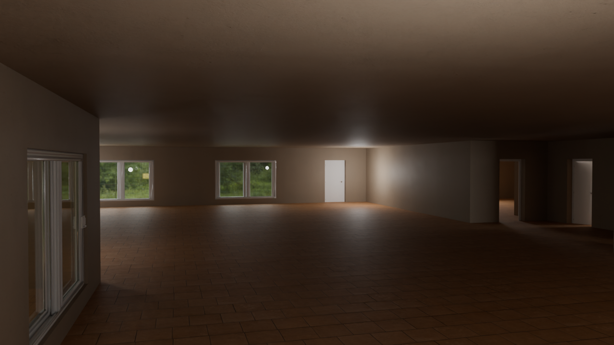</figure>
<figure>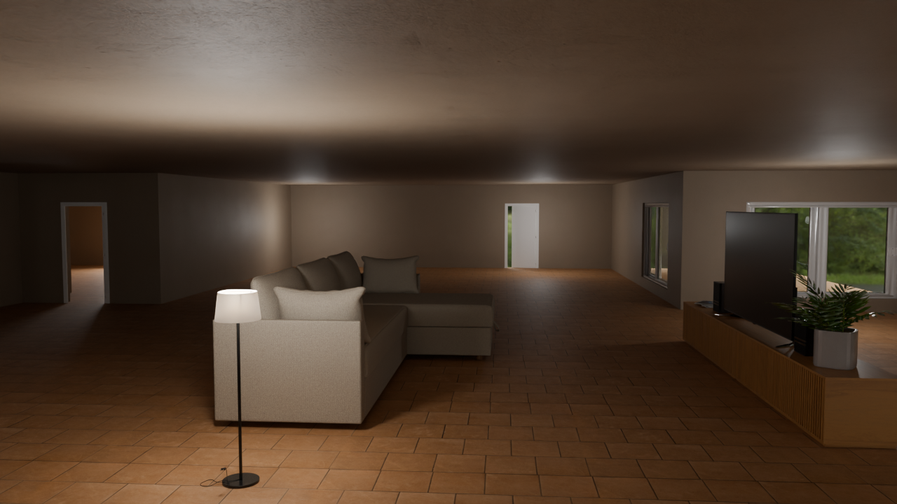</figure>
<figure>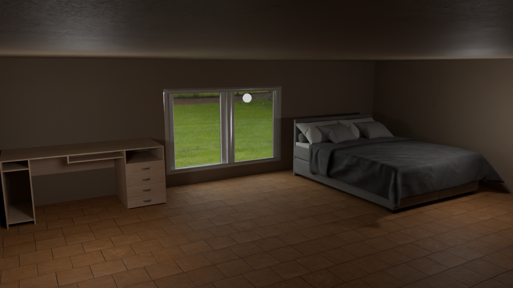</figure>
<figure>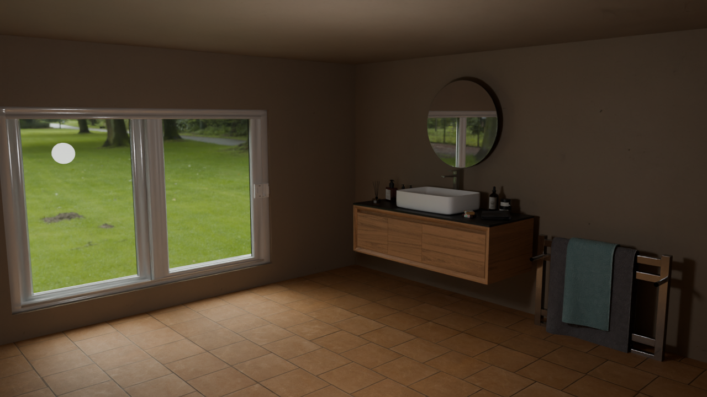</figure>

