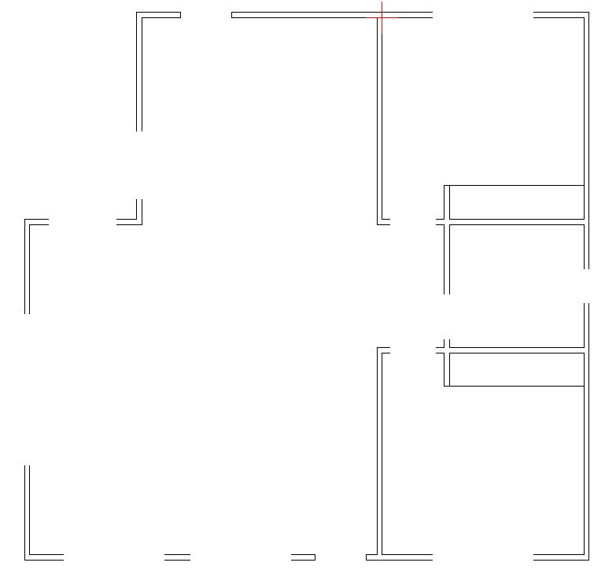
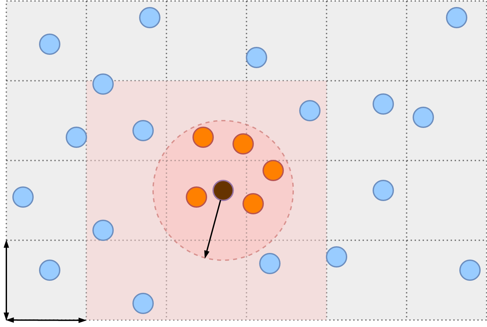

##### Implementazione di una pipeline per la generazione di mesh 3D a partire da modelli CAD 2D di planimetrie architettoniche
**Candidato:** Nome Simone Vaiasinni
**Relatore:** Prof. Nicola Capodieci
**Correlatore:** Prof. Fabio Pellacini

Laurea Magistrale in Informatica
UNIVERSITÀ DEGLI STUDI DI MODENA E REGGIO EMILIA - A.A. 2025/2026

---

<!-- 
DESCRIZIONE DEI PROBLEMI

1. i nomi dei layer/blocchi totalmente diversi (anche in lingue diverse)
2. le finestre a volte venivano rappresentate come buchi tra i muri mentre altre volte venivano sovrapposte ai muri, a volte veniva rappresentato il vetro interno e altre volte no, a volte venivano volte invece come un groviglio di segmenti, ecc.
3. le porte a volte rappresentate con l’anta e l’arco di apertura mentre altre come porta battente a 2 ante (ovvero con 2 archi), altre volte possono essere rappresentati come dei rettangoli.
4. la geometria presentasse talvolta del rumore e imperfezioni. Succedeva che erano presenti segmenti/punti residui lasciati durante la modifica del disegno, oppure i muri risultavano "rotti" (aperti) e non erano dei poligoni chiusi, estremità non coincidenti per piccole distanze
5. succedeva che nel caso delle porte queste venissero rappresentate o salvate in modo diverso, perché quando provavo a fare il parsing su modello (draftperson) funzionava mentre se provavo su un altro modello (archweb) non funzionava più nel senso che i segmenti venivano plottati in modo errato nonostante la procedura fosse uguale per entrambi.
6. L'unità di misura può cambiare da modello a modello

LE CAUSE

1. Il vero problema è che un file CAD 2D è un disegno grafico e non contiene la semantico dell’edificio. Una planimetria CAD contiene principalmente geometria: linee, archi, polilinee, cerchi, testi e riferimenti a blocchi (non esiste un’entità "porta" o "muro"). Ogni autore decide come disegnare gli elementi e come organizzarli, questo dipende molto anche dalle finalità del disegno: presentazione, progetto tecnico, rilievo, file didattico?
2. I nomi di layer/blocchi sono semplici etichette organizzative, non standard obbligatori. Un architetto disegna per un lettore umano, e un umano riconosce una porta dall’arco di apertura anche se sta su un layer chiamato A-XYZ-03. Ogni autore decide che nome assegnare a queste label.
3. Software diversi possono produrre DXF tecnicamente diversi anche per lo stesso disegno. Ad esempio l'unità di misura e il sistema di coordinate possono cambiare, oppure lo stesso elemento può avere rappresentazioni molto diverse. Per questo motivo se effettuo il parsing su un modello funziona mentre su un altro può dare problemi.

LA VERA SFIDA

L'algoritmo deve cercare di capire quali segmenti formano un muro, dove c’è un’apertura, se un blocco rappresenta una porta e se quel blocco è posizionato correttamente. Questo diventa difficile quando i disegni seguono convenzioni diverse. Quindi per ricostruire il 3D servono assunzioni sull’input, pulizia della geometria e regole di interpretazione.
-->

# Dal CAD 2D al modello 3D

## Obiettivo

Da una planimetria CAD di una **stanza o di un appartamento** generare un **modello 3D** (arredi esclusi), poi renderizzato in **Blender** con materiali e asset di porte e finestre.

## Problemi

- **Layer e blocchi** con nomi diversi, anche in lingue diverse
- **Porte e finestre** rappresentate in modi diversi (varchi, sovrapposizioni, archi singoli o doppi, rettangoli, grovigli di segmenti)
- **Rumore**: segmenti residui, muri aperti, estremità non coincidenti
- **Unità di misura** diverse; stesso parsing, risultati diversi

## Cause

- Un CAD 2D è un **disegno**, non un modello: solo geometria, nessuna entità "porta" o "muro"
- I nomi sono **etichette libere**, scelte dall'autore per un lettore umano
- **Software diversi** producono DXF tecnicamente diversi (unità, coordinate, rappresentazioni)

## La sfida

L'algoritmo deve capire **quali segmenti formano un muro**, **dove c'è un'apertura** e **se un blocco è una porta** posizionata correttamente.

Servono quindi: **assunzioni sull'input**, **pulizia della geometria** e **regole di interpretazione**.

---

<!-- 
Consideriamo il seguente modello CAD <immagine con disegno + layer + blocchi>

La fase di preprocessing ha l’obiettivo di rendere il modello più consistente prima di eseguire la pipeline. Si interviene correggendo manualmente le problematicità descritte prima: nomi dei layer/blocchi, correzioni della geometria, rimozione del rimore.

Per i nomi dei layer ho deciso di utilizzare nomi più espressivi, ad esempio: A-WALL, A-DOOR, A-WINODW, BLOCK-DOOR, BLOCK-WINDOW.

Il modello presenta inoltre sia muri interni (layer WALL-INTERNAL) sia muri esterni (layer WALL-EXTERNAL). Questi ultimi risultano ridondanti e possono essere rimossi. 

Se isolando solo i muri dal disegno possiamo osservare che sono incompleti (sembrano "rotti"), formano poligoni aperti. <immagine dei muri incompleti>

Anche le finestre hanno un sacco di rumore e presentano problemi di rappresentazione: ciascuna è composta da centinaia di segmenti, spesso sovrapposti tra loro; alcuni si estendono al di fuori della stanza, altri penetrano al suo interno.
Al termine della fase di correzione si ottiene il seguente risultato: <immagine del disegno è layer corretti>
-->

# Passo 0: Preprocessing

L'obiettivo è rendere il modello CAD <b>più consistente</b> prima di eseguire la pipeline

<figure>

<figcaption>Modello di partenza: disegno, layer e blocchi</figcaption>
</figure>

<h2>1. Nomi</h2>Layer e blocchi rinominati: <code>A-WALL</code> <code>A-DOOR</code> <code>A-WINDOW</code> <code>BLOCK-DOOR</code> <code>BLOCK-WINDOW</code>

<h2>2. Ridondanze</h2>Muri esterni (<code>WALL-EXTERNAL</code>) rimossi

<h2>3. Geometria</h2>Muri chiusi e rumore rimosso

---

# Correzione della geometria

<figure>

<figcaption><b>Muri aperti</b>Poligoni non chiusi: estremità che non coincidono</figcaption>
</figure>
<figure>

<figcaption><b>Finestre rumorose</b>Centinaia di segmenti sovrapposti, dentro e fuori dalla stanza</figcaption>
</figure>

---

# Risultato del preprocessing

<figure>

<figcaption>Prima</figcaption>
</figure>

&rarr;

<figure>

<figcaption>Dopo: layer e geometria corretti</figcaption>
</figure>

---

<!-- 
Parsing.

Il formato DXF organizza il disegno in primitive geometriche: LINE, POLYLINE, ARC, CIRCLE, ecc. Queste entità sono raggruppate in layer e blocchi (componenti riutilizzabili comunemente impiegati per rappresentare porte e finestre).

L’obiettivo della fase di parsing è estrarre da queste primitive le informazioni geometriche necessarie alla costruzione della mesh. Siccome sappiamo come sono strutturati i nomi dei layer/blocchi ci viene molto più facile estrarre le primitive collassando tutte le primitive sotto forma di segmenti, così da ottenere una rappresentazione uniforme.

Un segmento è semplicemente un coppia di vertici a cui viene associato un TAG che ne indica la semantica (muro, porta o finestra).

Quasi sempre, le primitive più uilizzate nei disegni sono: LINE (coppia di vertici), POLYLINE (contorno chiuso) e ARC. Questi ultimi sono tipici delle porte: si estrae il raggio, il punto base, l’angolo iniziale e finale e a partire da questi dati si calcolano i due punti estremi.

Per verificare la correttezza del parsing si utilizza uno script Python che effettua il plot dei segmenti estratti: <parsing.png>

-->

# Passo 1: Parsing

## Primitive DXF

- <code>LINE</code>, <code>POLYLINE</code>, <code>ARC</code>, <code>CIRCLE</code>...
- Raggruppate in **layer** e **blocchi**

&darr;

## Segmenti con tag

- **Coppia di vertici** + **TAG** (muro, porta, finestra)
- Rappresentazione **uniforme**

## Caso ARC (porte)

Dall'arco si ricavano il base point $p$, il raggio $r$ e gli angoli $\theta_0$, $\theta_1$, da cui i **due estremi**

<figure>
  

<figcaption>Segmenti estratti: muri, porte e finestre distinti per colore</figcaption>
</figure>

---

<!-- 
Collasso dei vertici

Nei disegni CAD è comune che in uno stesso punto siano presenti vertici (appartenenti a segmenti diversi) sovrapposti oppure molto vicini da essere indistinguibili.
Questa operazione serve sia a ridurre il numero di vertici da elaborare ma soprattutto per riuscire a rappresentare la geometria come grafo con vertici univoci.

L’obiettivo è prendere l’insieme dei segmenti e rimuovere vertici che sono considerati in più, ovvero che distano meno di $epsilon$. Per risolvere questo problema in modo efficiente si è scelto di implementare una struttura dati spaziale efficiente: un hash spaziale.
Il funzionamento è semplice: lo spazio 2D viene suddiviso in una griglia regolare, in cui ogni cella ha una dimensione fissa. A ciascun punto viene associata esattamente una cella, calcolata in base alle sue coordinate (posizione).
Una proprietà interessante di questa struttura è che se la dimensione della cella è scelta pari al raggio di ricerca 𝑟, due punti che distano meno di 𝑟 si trovano necessariamente nella stessa cella oppure in una delle celle immediatamente adiacenti.
Questo significa che, per rispondere a un’interrogazione centrata in un punto 𝑝, non è necessario esaminare l’intero insieme di punti, ma è sufficiente fare una ricerca nella griglia 3x3
<2_background_teorico/cell_list.png>

Il parametro epsilon definisce il raggio di ricerca 𝑟 e di conseguenza la dimensione della cella. 
Dato un punto 𝑝, cerca nella griglia 3x3 un vertice già esistente che disti meno di epsilon; se esiste già il nuovo vertice viene scartato senza essere inserito nella griglia, altrimenti viene inserito.
In questo caso è stato utilizzato epsilon=10^(-2) per avere una riduzione di circa il 50% dei vertici. In generale non esiste un valore unico per tutti i modelli, occorre provare e verificare.

Durante la creazione della struttura spaziale prendo ogni singolo segmento (dei muri) e rimuovo i duplicati, ma allo stesso tempo mi salvo gli archi Edge con riferimenti ai due vertici estremi. Alla fine io otterrò sia l'insieme dei vertici univoci V, sia anche la lista degli archi E. Praticamente un grafo.
-->

# Passo 2: Collasso dei vertici

<figure>

<figcaption>Hash spaziale: ricerca nelle 3×3 celle attorno a $p$</figcaption>
</figure>

## Problema

Vertici di segmenti diversi **sovrapposti** o **quasi coincidenti**

## Hash spaziale

Griglia con celle di lato $\varepsilon$: i vertici a distanza $< \varepsilon$ stanno nella stessa cella o in una **adiacente**, quindi basta cercare nelle **3×3 celle**

## Regola

Esiste un vertice a distanza $< \varepsilon$? **Scarta** il nuovo, altrimenti **inseriscilo**. Con $\varepsilon = 10^{-2}$: circa **50%** di vertici in meno

## Risultato

Un **grafo**: vertici univoci $V$ e archi $E$

